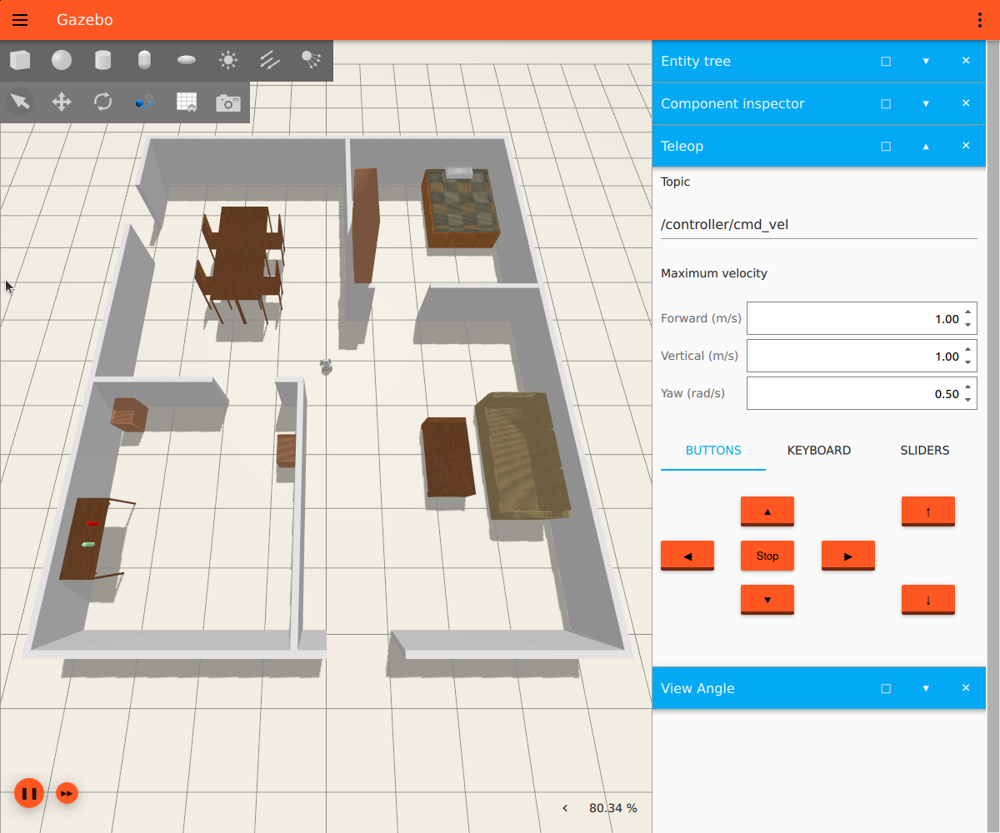
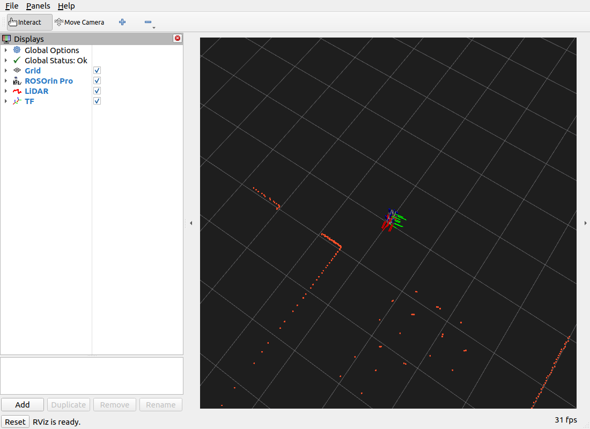

# Phase B/C verification — ROSOrin Pro

Date: 2026-10-13 (Asia/Ho_Chi_Minh). Results below are from the actual simulation,
not vendor benchmark numbers. This records the earlier B/C milestone; mapping
and navigation subsequently passed in [the D/E/F report](phase_d_e_f_results.md).

## Phase B — Build and Gazebo

- **Objective:** run the official ROSOrin room and robot in Gazebo.
- **Actions performed:** verified installed runtime packages, sourced the dedicated
  overlay, ran the local room wrapper, diagnosed the vendor controller crash,
  adapted only the runtime description and launch, and restarted simulation.
- **Files created/modified:** `launch/room.launch.py`, `config/sensors.rviz`,
  `scripts/run.sh`, `scripts/verify_control_sensors.py`, README, this report,
  and actual results in `results/runtime/`.
- **Verification and actual results:** all runtime package lookups passed;
  spawn returned `OK creation of entity`; the room, furniture and robot are
  visible in the captured Gazebo window. Robot state publisher and bridge run.
  Earlier package build passed for both vendor packages.
- **Issues/root causes:** vendor controller manager and embedded ros2_control
  plugin try to load URDF without a `<ros2_control>` hardware declaration. The
  node aborts and joint-state controller spawner cannot connect. The model already
  contains independent Gazebo MecanumDrive and JointStatePublisher plugins.
- **Fixes applied:** do not start controller manager/joint broadcaster spawner;
  remove only the incomplete ROS2ControlPlugin from the expanded runtime URDF.
  Keep vendor Xacro/assets unchanged and use its existing MecanumDrive. Bypass
  the unused holonomic_sim lookup. Bridge the required simulation topics and do
  not publish static map-to-odom. No driver or shell startup changes.
- **Status: PASS.** Robot spawn, running world and actual sensor/motion checks
  corroborate the successful simulator setup.
- **Next phase:** Phase C, completed below.

## Phase C — Control, LiDAR and TF

- **Objective:** demonstrate actual forward/backward/left/right movement and
  valid LiDAR visualization with connected coordinate frames.
- **Actions performed:** ran the verification script with 0.15 m/s translation
  and 0.3 rad/s rotation commands, each for 1.5 simulation seconds, with stop
  commands between segments; subscribed to odometry/scan, checked TF, and opened
  RViz with the sensor config. Commands were automated, not manual keyboard
  trials. The vendor keyboard teleop is included as a reproduction command.
- **Files created/modified:** actual JSON and text output, Gazebo/RViz screenshots,
  and node/topic inventories; scripts/config/docs listed above.
- **Verification commands:** `bash part1_rosorin/scripts/run.sh verify`,
  `ros2 node list`, `ros2 topic list -t`, `ros2 topic info /scan -v`, and RViz
  with `use_sim_time:=true`. The command sequence and outcomes are in the README
  and linked evidence files.
- **Actual results:** all four signed-motion checks passed. LiDAR has 270 samples,
  260 finite in-range values in the saved final scan, frame `lidar_frame`,
  76 messages during the test and 10.0 Hz per simulation second. Timestamp reached
  30.21 s and increased throughout the observation. Odometry frame is `odom`,
  child `base_footprint`. TF lookup succeeds for `odom -> base_footprint`,
  `odom -> base_link`, and `odom -> lidar_frame`. RViz screenshot shows Global
  Status OK, visible orange scan points and connected frame axes.
- **Issues/root causes:** turn commands exhibit translation drift and asymmetric
  yaw response with the vendor wheel geometry/physics. The smoke test proves
  signed movement, not calibrated tracking accuracy. EGL warnings occurred,
  but sensors and visualization operated. GNOME denied full-desktop screenshot;
  evidence was captured from the two simulation windows instead.
- **Fixes applied:** no changes to wheel physics, velocity calibration or drivers.
  Preserve these observations for later SLAM/navigation tuning if needed.
- **Status: PASS.** Actual motion, valid sensor data and RViz/TF verified.
- **Next phase:** wait for user approval before Phase D (SLAM), then Phase E.

| Command | Measured signed translation | Measured yaw change | Check |
| --- | ---: | ---: | --- |
| Forward | +0.179999 m | approximately 0 rad | PASS |
| Backward | -0.180000 m | approximately 0 rad | PASS |
| Turn left | -0.046922 m along initial heading | +0.542379 rad | PASS |
| Turn right | -0.060123 m along initial heading | -0.366714 rad | PASS |

Translation acceptance is greater than 0.03 m in the commanded direction;
rotation acceptance is greater than 0.08 rad in the commanded direction.
This is one sequence of four smoke tests, not a statistical performance claim.
The odometry is the vendor Gazebo model-pose publisher, so these measurements
reflect the simulated model pose. No ground-truth robot-hardware claim is made.

## Evidence and reproduction

- [Measured JSON](../results/runtime/control_sensors.json)
- [Control/sensor console log](../results/runtime/control_sensors.log)
- [Successful room launch log](../results/runtime/room_launch.log)
- [First launch: controller failure](../results/runtime/first_launch.log)
- [ROS topics](../results/runtime/topics.txt)
- [ROS nodes](../results/runtime/nodes.txt)
- [LiDAR topic and QoS](../results/runtime/scan_topic_info.txt)
- [README commands](../../README.md)

Actual installed ROS packages include `ros-humble-ros-gz-bridge`
`0.244.26-1jammy.20260915.210000`, `ros-humble-ros-ign-gazebo`
`0.244.26-1jammy.20260908.011812`, and `ros-humble-ign-ros2-control`
`0.7.21-1jammy.20261006.001819`. Remaining reproducibility limits include
placeholder vendor license declarations and no clean-machine runtime rerun yet.
