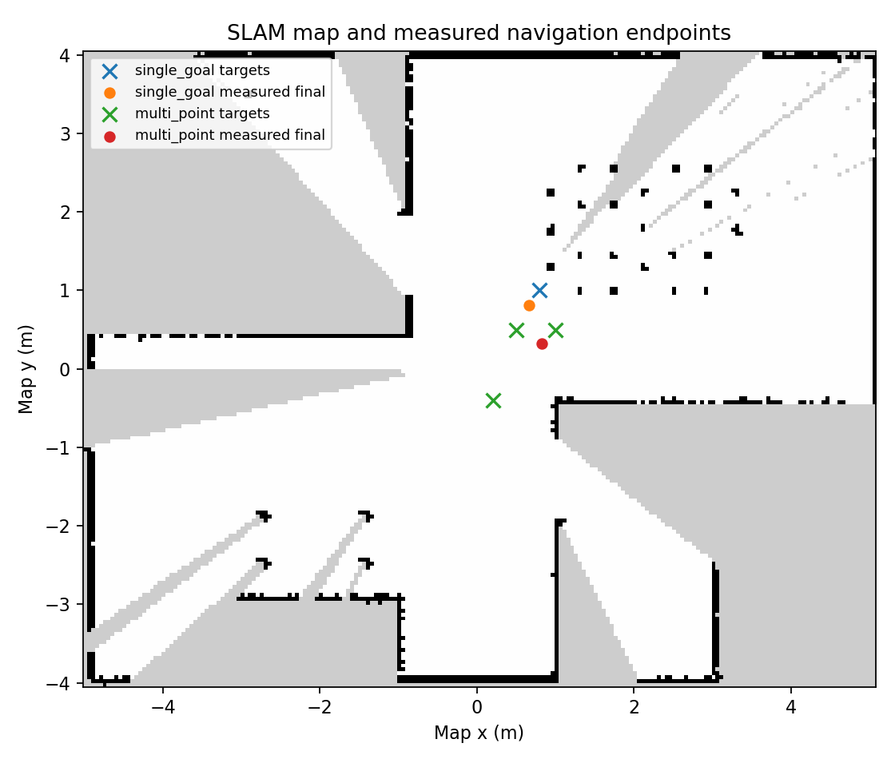

# Phase D/E/F — SLAM, navigation and deliverables

Date: 2026-10-13 (Asia/Ho_Chi_Minh). All measurements refer to real Gazebo runs.

## Phase D — SLAM and mapping

- **Objective:** generate a map from simulated LiDAR, save it, and make it usable
  for subsequent navigation.
- **Actions performed:** launched SLAM Toolbox with vendor `slam.yaml`, observed
  `/map` in RViz, rotated the robot through all headings, saved YAML/PGM, captured
  the robot pose in map coordinates, and stopped SLAM before AMCL.
- **Files created/modified:** `launch/slam.launch.py`, `scripts/mapping_sweep.py`,
  `scripts/capture_pose.py`, `config/navigation.rviz`, `maps/room_slam.*` and
  `maps/room_demo.*`; mapping/save logs and pose JSON files.
- **Verification and actual results:** map saver printed `Map saved successfully`.
  First map: 203 x 162 cells. Restarted-run map: 202 x 162. Both use 0.05 m/cell
  and a relative PGM image reference. Map server later loaded both files and
  reported the expected dimensions. Live RViz map updates are in the demo.
- **Issues/root causes:** vendor top-level mapping launch is absent; include
  launch has unnecessary environment access and an extra RViz argument. The
  wrapper starts the same SLAM Toolbox executable with the unchanged vendor
  configuration. Ceres caps the configured 50 threads at the compiled maximum
  of 24. The map retains unknown regions because exploration is limited.
- **Fixes applied:** local launch wrapper with simulation time, no static
  map-to-odom transform, explicit map saving and handoff pose capture. No new
  SLAM algorithm or vendor source modification.
- **Status: PASS.** Actual SLAM output saved and reloaded by map server.
- **Next phase:** saved-map localization/navigation, completed below.

## Phase E — Autonomous single-goal and multi-point navigation

- **Objective:** navigate on the saved map and verify each requested goal really
  completes, instead of relying on a displayed path.
- **Actions performed:** stopped SLAM, loaded the map through installed Nav2
  bringup, initialized AMCL with the captured mapping pose, activated the
  navigation lifecycle nodes, sent NavigateToPose and FollowWaypoints actions,
  and repeated the full pipeline after restarting Gazebo.
- **Files created/modified:** `launch/navigation.launch.py`, derived `config/nav2.yaml`,
  `scripts/prepare_nav_config.py`, `scripts/navigation_trials.py`,
  `config/start_pose.json`, action-result JSON, logs, CSV and endpoint figure.
- **Verification and actual results:** both localization and navigation lifecycle
  managers reported managed nodes active. All four episode-level actions returned
  SUCCEEDED. Both waypoint actions completed all three requested waypoints with
  an empty missed-waypoint list. TF-based final position errors are in the table.
- **Issues/root causes:** vendor controller configuration mixes simulation time
  true/false; AMCL defaults to a differential model despite the mecanum chassis;
  costmap radius 0.07 m is undersized. Nav2 produces `/cmd_vel`, whereas the
  Gazebo drive uses `/controller/cmd_vel`. At initialization, AMCL logged a
  transient 0.03-second TF extrapolation warning; subsequent odometry/localization
  updates resolved the handoff and actions completed.
- **Fixes applied:** enabled simulation time consistently, selected the installed
  `nav2_amcl::OmniMotionModel`, used a 0.16 m costmap radius, and bridged Nav2's
  smoothed velocity to the vendor Gazebo drive topic. Reused DWB, Navfn and the
  remaining vendor parameter values. Used standard Nav2 bringup and actions;
  no planner/controller algorithm was rewritten.
- **Status: PASS.** Measured motion, successful actions, no missed waypoints.
- **GUI verification:** the vendor Navigation 2 panel and GoalTool plugin load
  successfully. The panel reports Navigation active and Localization active and
  exposes Waypoint / Nav Through Poses Mode. The measured trials use actions,
  not manual mouse clicks.
- **Next phase:** documentation/demo and evidence verification, completed below.

| Run | Task | Outcome | Wall time (s) | Simulation time (s) | Final position error (m) |
| --- | --- | --- | ---: | ---: | ---: |
| 1 | Single goal | SUCCEEDED | 4.77 | 6.78 | 0.230 |
| 1 | Three waypoints | SUCCEEDED, none missed | 22.71 | 22.71 | 0.217 |
| 2, Gazebo restarted | Single goal | SUCCEEDED | 9.37 | 11.37 | 0.236 |
| 2, Gazebo restarted | Three waypoints | SUCCEEDED, none missed | 20.55 | 20.55 | 0.248 |

Single-goal target: `(0.8, 1.0, -pi/2)`. Waypoint sequence:
`(0.5, 0.5, -pi/2)`, `(0.2, -0.4, -pi/2)`, `(1.0, 0.5, 0)`.
All coordinates are in the saved map frame. Episode success requires SUCCEEDED,
no missed waypoints and final position error at most 0.35 m; measured errors
also lie within the vendor's 0.25 m positional goal tolerance. These four episodes
are a small verification set: 4/4 succeeded, not an estimate of broad reliability.
Pose errors are based on AMCL/TF, not independent external ground truth.

## Phase F — Verification, reproduction and deliverables

- **Objective:** produce reviewable source/configs/commands, measured results,
  a short Part 1 report and a 3–5 minute demo.
- **Actions performed:** exported result JSON to CSV, plotted the real map and
  measured endpoints, generated a three-page PDF, recorded Gazebo/RViz windows
  during the restarted pipeline, added time-aligned captions, inspected video
  frames/PDF and checked Python/shell syntax.
- **Files created/modified:** root README, Part 1 README, phase reports, scripts,
  configurations, maps, selected console logs and images, CSV, report PDF,
  `demos/README.md` and local recordings.
- **Verification and actual results:** four action-result records pass; saved map
  metadata and PGM dimensions match; report opens as a three-page A4 PDF; final
  video has a 180.000-second duration. Script syntax checks passed. The vendor
  robot Xacro SHA-256 matches the unchanged archive entry. Reproduction was
  checked by restarting Gazebo on the same host, not by installing a clean OS.
- **Issues/root causes:** the original whole-desktop screenshot request was denied
  by GNOME; the two simulation windows were captured directly. Video captions
  are in a separate top band to keep the views unobstructed. The map still has
  unknown areas; turning exhibits drift. No physical robot, collision-rate
  metric, large evaluation or Part 2 result is claimed.
- **Fixes applied:** documented the actual commands, minimal runtime adaptations,
  measured limitations and artifact provenance. `.gitignore` excludes vendor
  downloads, upstream source, build outputs, internal ROS logs and recordings,
  while preserving source/config/maps/selected evidence.
- **Status: PASS for local Part 1 deliverables.** No commit/push or external
  video upload was performed. Publish the video link before final submission.
- **Next phase:** user review; Part 2 and the combined 5–7 page report are separate.

## Artifacts

- [README and commands](../../README.md)
- [Final demo and recording notes](../../demos/README.md)
- [CSV measurements](../results/runtime/navigation_summary.csv)
- [Run 1 raw result](../results/runtime/navigation_trials.json)
- [Run 2 raw result](../results/runtime/navigation_trials_demo.json)
- [Map statistics](../results/runtime/map_summary.json)
- [Map save log](../results/runtime/map_save_demo.log)
- [Nav2 console log](../results/runtime/navigation_demo.log)
- [Action client log](../results/runtime/navigation_trials_demo.log)
- [Final RViz screenshot](../results/runtime/navigation_final_rviz.png)
- [Final Gazebo screenshot](../results/runtime/navigation_final_gazebo.png)
- [Navigation 2 panel active](../results/runtime/navigation_panel.png)

The Part 1 report is submitted together with Part 2 and is not part of this repository.
